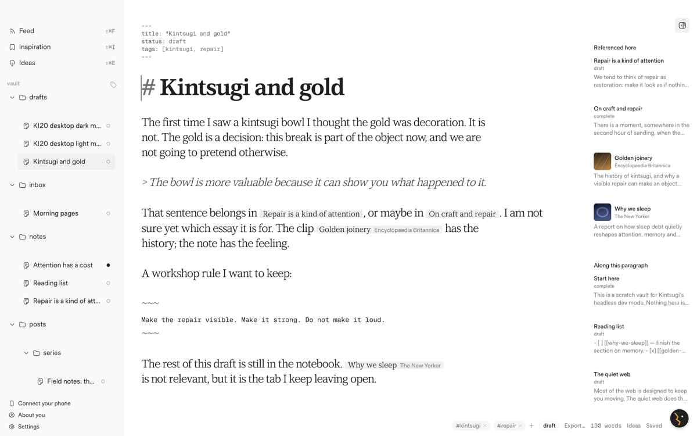
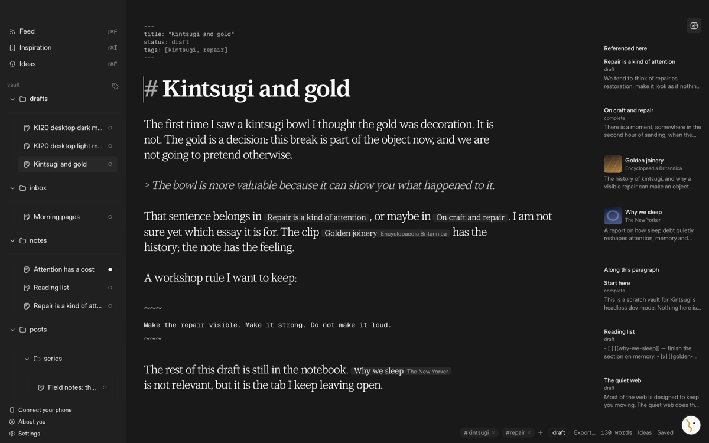
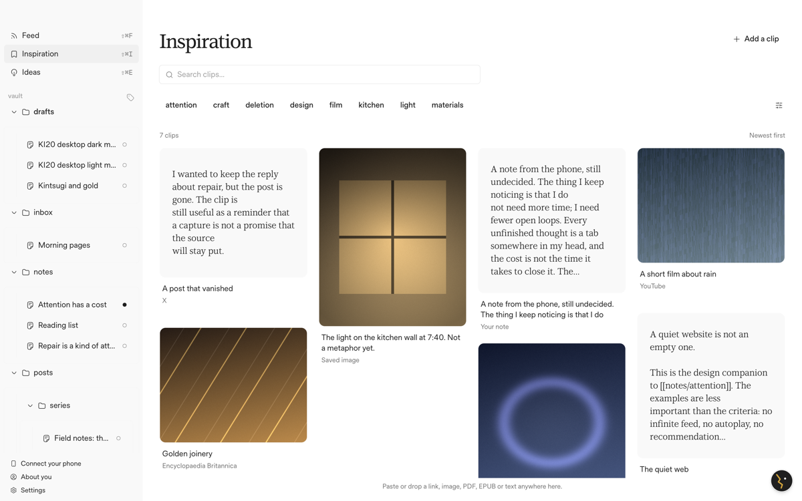
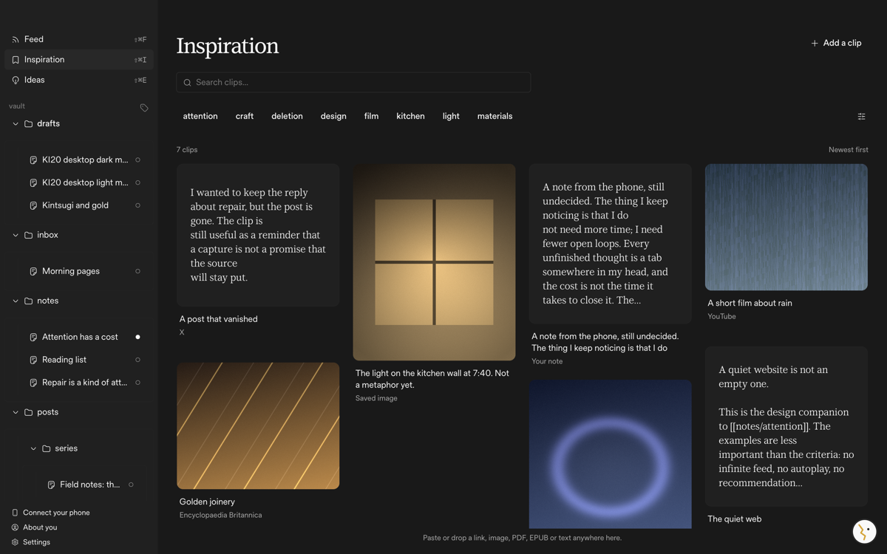
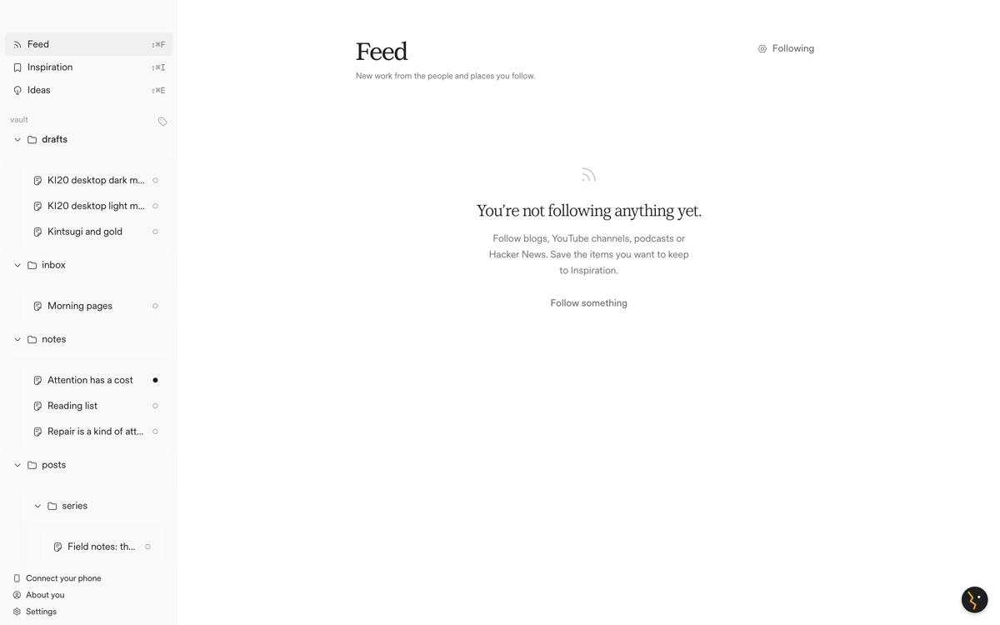
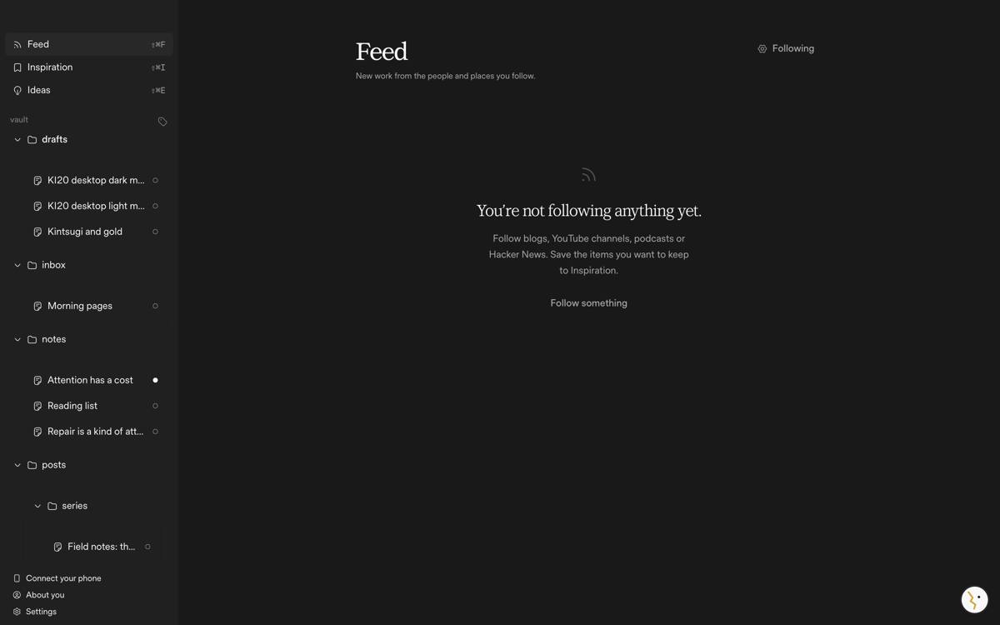
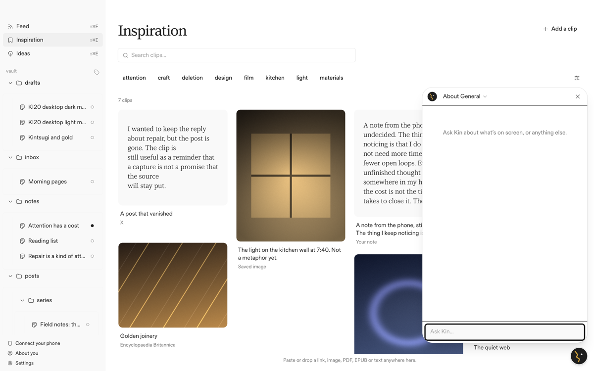
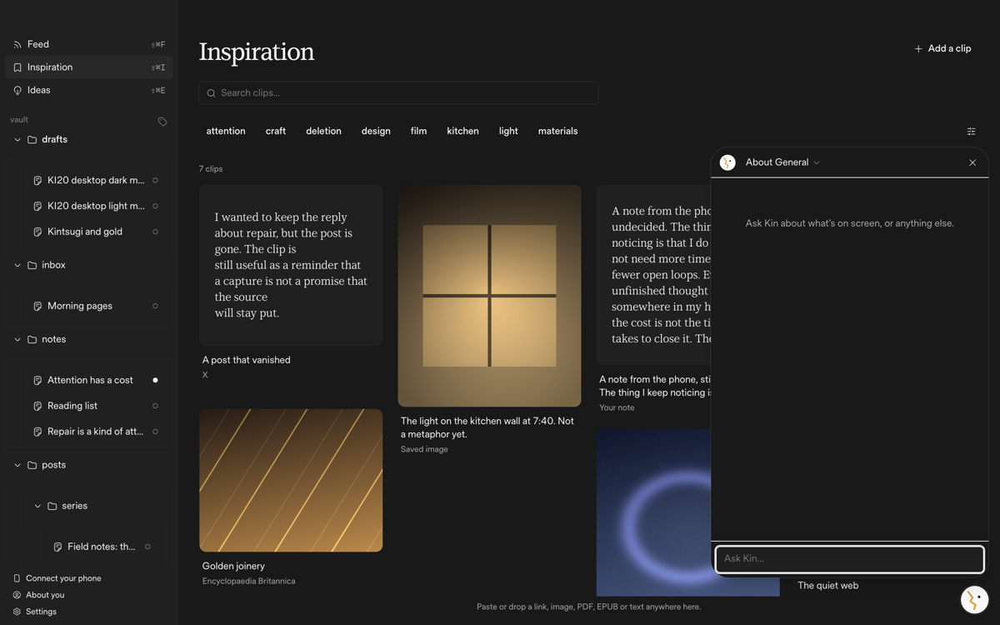

# Graphical Kintsugi theme coverage

The Mac app and `@kintsugi/ui` use the Graphical "Kintsugi" theme (revision
`74tv5u2yagr6`) and ship its full Base UI component set. This page lists what
is connected, where to import it, and what isn't covered yet.

The phone app (Expo / React Native) is out of scope: Base UI components are
DOM components and don't run there.

## Setup

```tsx
import { KintsugiProvider } from "@kintsugi/ui/provider";
import { Button, Select, Toggle, theme } from "@kintsugi/ui/graphical";
import { Button as AppButton } from "@kintsugi/ui/components/button";
import { Search } from "@kintsugi/ui/icons";
```

- `@kintsugi/ui/graphical` is `packages/ui/components/graphical/index.ts`: the
  bundled components, their runtime and the theme document.
- `@kintsugi/ui/styles.css` imports the Graphical stylesheet once, in Tailwind's
  components layer, plus the fonts. The Mac app imports it from
  `apps/desktop/src/index.css`. Don't also import
  `@kintsugi/ui/graphical/styles.css`.
- `KintsugiProvider` (in `apps/desktop/src/main.tsx`) supplies the theme, the
  icon renderer and the tooltip provider. Its color mode follows `html.dark`,
  which the app sets from the system appearance. Pass `colorMode` to force one.
- shadcn's semantic colors (`bg-muted`, `text-muted-foreground`, `border` and
  the rest) are aliases of theme tokens, defined on the theme scope and on popup
  roots, so screens that use them follow the theme in both modes. Tailwind's
  `text-xxs` to `text-xl`, radii and font families map to the theme scale.
- App-specific roles live in `apps/desktop/src/theme.css` (`ki-*` classes).
- The CodeMirror theme (`packages/editor/src/theme.ts`, `references.ts`) uses
  the theme's editorial, data and UI type roles and its neutral colors.
- Guidance for later UI work: `GUI.md`, `gui/` and the `graphical-ui`,
  `graphical-convert` and `graphical-audit` skills in `.agents/skills/`.

## Base UI catalog

All 38 components are the bundled source, exported from
`@kintsugi/ui/graphical`. `pnpm --filter @kintsugi/ui test` checks every
variant, mode, part and state of each one against its captured specification
(`packages/ui/src/components/graphical.test.ts`, `packages/ui/src/contrast.test.ts`).

| Component | Import |
| --- | --- |
| Accordion | `Accordion` |
| Alert dialog | `AlertDialog` |
| Autocomplete | `Autocomplete` |
| Avatar | `Avatar` |
| Button | `Button`, `ButtonContent` |
| Checkbox | `Checkbox` |
| Checkbox group | `CheckboxGroup` |
| Collapsible | `Collapsible` |
| Combobox | `Combobox`, `ComboboxField` |
| Context menu | `ContextMenu` |
| Dialog | `Dialog` |
| Drawer | `Drawer` |
| Field | `Field` |
| Fieldset | `Fieldset` |
| Form | `Form` |
| Input | `Input`, `InputLabel` |
| Menu | `Menu` |
| Menubar | `Menubar` |
| Meter | `Meter` |
| Navigation menu | `NavigationMenu` |
| Number field | `NumberField` |
| OTP field | `OTPField` |
| Popover | `Popover` |
| Preview card | `PreviewCard` |
| Progress | `Progress` |
| Radio | `Radio` |
| Radio group | `RadioGroup` |
| Scroll area | `ScrollArea` |
| Select | `Select`, `SelectField` |
| Separator | `Separator` |
| Slider | `Slider` |
| Switch | `Switch` |
| Tabs | `Tabs` |
| Toast | `Toast` |
| Toggle | `Toggle` |
| Toggle group | `ToggleGroup` |
| Toolbar | `Toolbar` |
| Tooltip | `Tooltip` |

Base UI's non-visual helpers `CSPProvider`, `DirectionProvider`, `mergeProps`
and `useRender` are re-exported unchanged.

Only `Toggle` (Inspiration tag filters) is used directly by a screen today. The
rest are ready to import; they are covered by the specification tests, not yet
by a rendered screen.

## Shared components

`@kintsugi/ui/components/<name>` keeps its import paths and APIs. Each one now
draws its parts from the Graphical resolver while keeping its Radix, cmdk,
Sonner or native behavior.

| Component | Graphical source |
| --- | --- |
| badge | Button appearances and theme foundations (no badge spec in the kit) |
| button | Button variants, label and control parts; existing sizes and `asChild` |
| collapsible | Collapsible parts |
| command | Combobox parts; cmdk filtering and keyboard behavior |
| context-menu | Context menu parts |
| dialog | Dialog backdrop, popup, title and description |
| input-group | Text field surface |
| input | Text field parts |
| kbd | Data typography |
| popover | Popover parts |
| separator | Separator edge |
| sheet | Drawer appearances (no swipe to dismiss; use `Drawer` for that) |
| sidebar | Navigation and button parts |
| skeleton | Theme foundations and motion |
| sonner | Toast parts; the existing `toast()` API |
| switch | Switch control and thumb |
| textarea | Text field parts |
| tooltip | Tooltip parts; provider installed by `KintsugiProvider` |

## Screens

| Screen | Status |
| --- | --- |
| App shell, empty state, document footer | Converted to `ki-*` roles |
| Sidebar, tree, tag filter | Converted |
| Palette | Converted |
| Inspiration library, clip cards, capture, clip detail | Converted |
| Writing, reference margin, Used in | Converted |
| Refine | Converted |
| Phone dialog, headless dialogs | Converted |
| Feed, sources, picked | Themed through the semantic aliases; type sizes moved onto the theme scale; page title uses `ki-title` |
| Ideas (ledger, beside, cards) | Themed through the semantic aliases; the Kin accent now reads `--kin` / `--kin-ink` |
| Kin chat, About you, Settings | Themed through the semantic aliases; Settings got no other changes |
| Publish and Export dialogs | Dialog chrome moved to theme tokens; the warning color is `--warning` |
| Comments in the editor | Themed through the editor theme |

### Gaps

- Feed, Ideas, Kin, Publish and Export still use Tailwind layout utilities
  rather than `ki-*` roles. They follow the theme's colors, type scale and
  radii, but haven't had a line-by-line conversion.
- The Publish preview and the Export page previews keep their own type and
  white page background on purpose: they show the blog and the exported file.
- Kin's avatar keeps its fixed accent stroke (`#d4a53c`); it is artwork.
- Settings and the Kin developer panel use native `<select>` and checkbox
  elements. Settings is about to become a full page, so they weren't swapped
  for `Select` and `Checkbox` here.
- The kit's alternate icon families (Central, Phosphor, filled Lucide artwork
  tables) stay in the vendored source but are never selected by this theme.
- The theme's tracking for `xxs` text is +0.005em. No screen uses `xxs` text as
  a label above a heading.

## Fonts

| Family | Weights | License |
| --- | --- | --- |
| Timeless Sans (UI) | 400, 500, 600 | Timeless Free Font License v1.3, elected by the owner on 2026-10-31 |
| LT Superior Serif (editorial) | 400, 500, 700 | SIL Open Font License 1.1 |
| Geist Mono, as "Sidebar Geist Mono" (data) | 400, 500, 600 | SIL Open Font License 1.1 |

Files, hashes and license notes: `packages/ui/src/fonts/README.md`. License
copies ship in `apps/desktop/public/font-licenses/`. Timeless Sans is upright
only, and LT Superior Serif has no italic face, so italics are synthesized.

## Icons

Hugeicons free, stroke-rounded (`@hugeicons/core-free-icons` 4.x and
`@hugeicons/react`, MIT). `lucide-react` is gone. The app imports icons from
`@kintsugi/ui/icons`, which keeps the old component names
(`Search`, `Trash2`, `Lightbulb`…) and renders Hugeicons artwork. The bundled
Graphical components render the same set. The license is recorded in
`THIRD_PARTY_NOTICES.md`.

Names with no direct free equivalent, and the glyph used instead:

| Old name | Hugeicons glyph |
| --- | --- |
| `Loader2` | `Loading03Icon` |
| `Wand2` | `MagicWand01Icon` |
| `Swords` | `Sword01Icon` (one sword) |
| `NotebookPen` | `Notebook01Icon` (no pen) |
| `Pilcrow` | `ParagraphIcon` |
| `FileDiff` | `FileDiffIcon` |
| `UserRound` | `UserCircleIcon` |
| `MessagesSquare` | `MessageMultiple01Icon` |

## Checking it

With `pnpm desktop:headless` running, `KINTSUGI_THEME_URL='<printed URL>' node
scripts/check-desktop-theme.mjs` opens the app in headless Chrome in light and
dark. It checks the theme scope and color mode, that Timeless Sans and LT
Superior Serif load, that page titles sit on the theme scale and that every
icon on screen is Hugeicons, then saves screenshots of writing, the palette,
Feed, Inspiration, capture, Ideas, Kin chat and Settings to
`.headless/ki-20/desktop/`.

Screenshots from the seeded scratch vault:

| Light | Dark |
| --- | --- |
|  |  |
|  |  |
|  |  |
|  |  |
