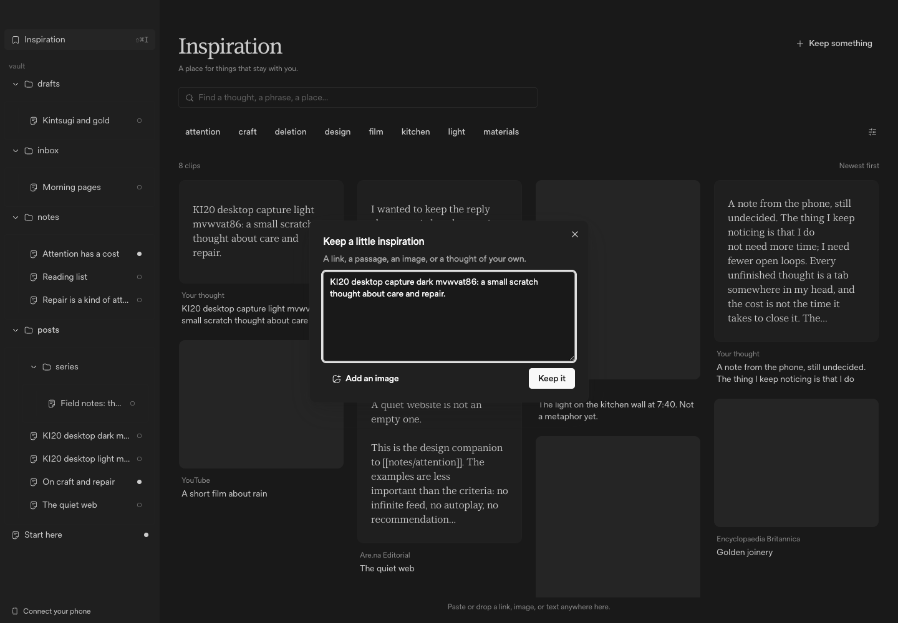
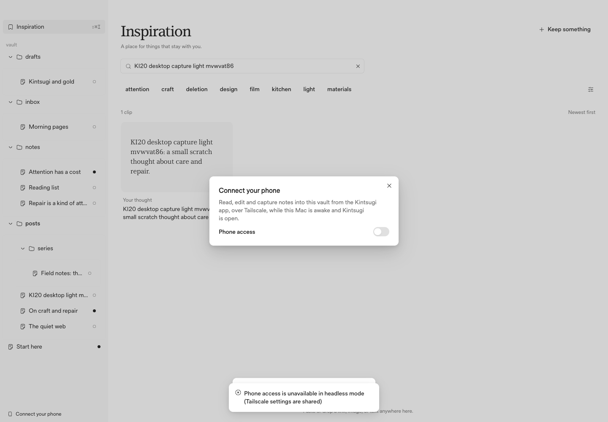
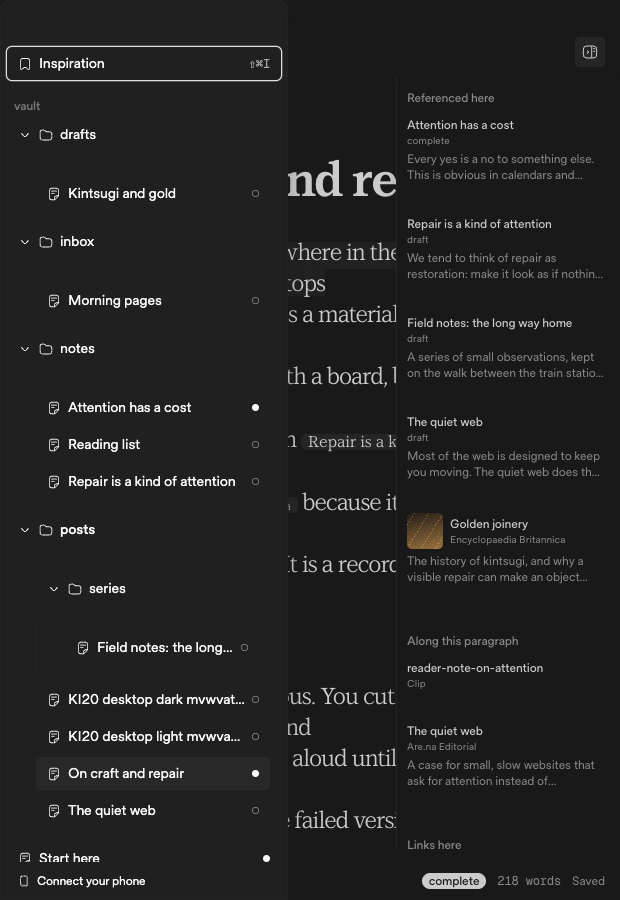
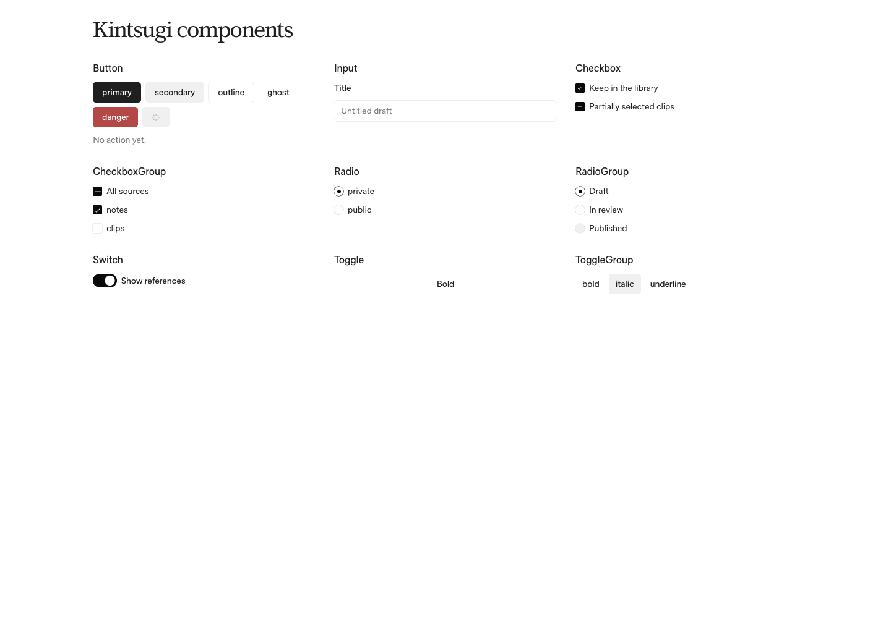
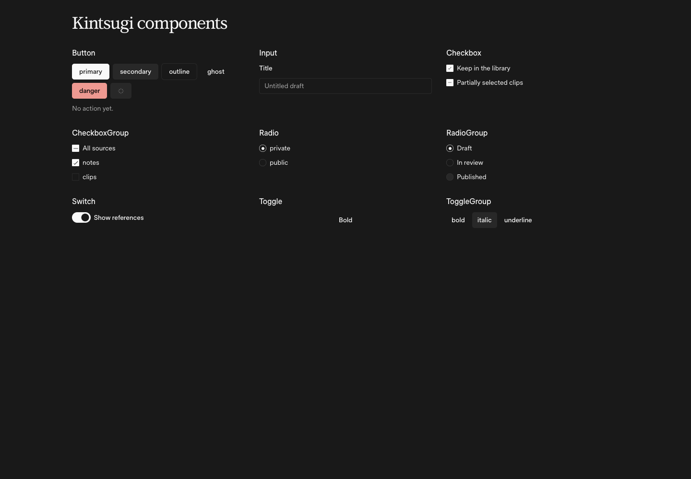
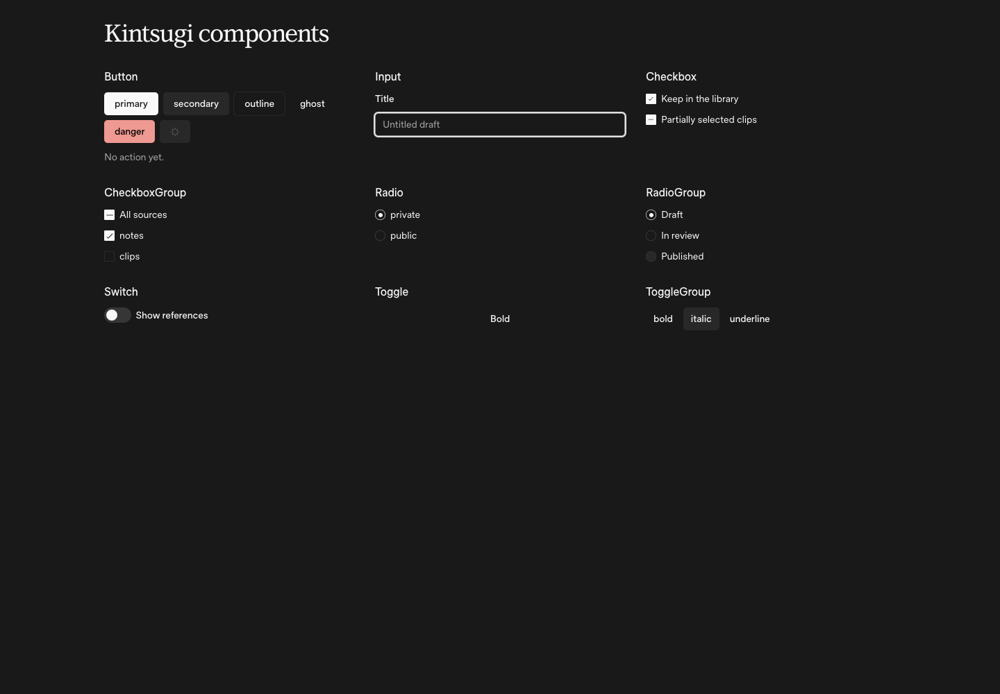
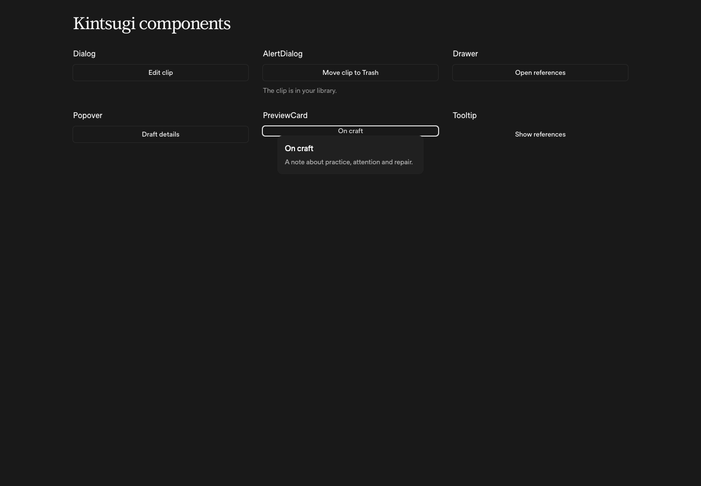

# KI-20 — Graphical Kintsugi integration

## Result

The exact Graphical revision `74tv5u2yagr6` is integrated across the shared DOM
UI, desktop screens, CodeMirror and Lab entries. The owner-approved dark contrast
correction is applied. **All selected upright fonts and requested weights are
installed:** LT Superior Serif 400/500/700, Timeless Sans 400/500/600 and Geist
Mono 400/500/600. Palette values, light-mode assignments and Charter/Paper
identity remain unchanged.

**Timeless's license gate is resolved by explicit owner election of the vendor's
v1.3 contract on 2026-10-31.** The original, unmodified Sans WOFF2 is shipped with
the complete current contract and election/provenance NOTICE. See the font table
and `packages/ui/src/fonts/README.md`. No font/contrast human gate remains.

Mobile (Expo/React Native) is blocked/excluded: DOM Base UI components do not
apply. A separate native implementation is required. The Lab shell chrome is
excluded and remains owned by KI-19; only preview/entry rendering is themed.

## Imports and ownership

```tsx
import { KintsugiProvider } from '@kintsugi/ui/provider';
import {
  GraphicalProvider, IconRendererProvider, createHugeiconsRenderer,
  theme, Button, Input, Select, SelectField, Combobox, ComboboxField,
} from '@kintsugi/ui/graphical';
// Existing APIs remain available, including asChild, refs and callbacks:
import { Button as AppButton } from '@kintsugi/ui/components/button';
import { Search } from '@kintsugi/ui/icons';
```

- `@kintsugi/ui/graphical` is `packages/ui/components/graphical/index.ts`, the
  public entry for the actual downloaded components, runtime and captured theme.
- `@kintsugi/ui/styles.css` imports the bundled stylesheet **once**, in Tailwind's
  components layer. Apps import this shared stylesheet at their CSS entry.
  `@kintsugi/ui/graphical/styles.css` is also exported for consumers that do not
  use the shared stylesheet; do not import both.
- `KintsugiProvider` supplies the captured document, free Hugeicons renderer and
  compatibility tooltip provider. Its color mode watches the host's actual
  `html.dark` state. Desktop keeps its existing live system preference listener;
  Lab scenarios update that same class. An explicit `colorMode` is also supported.
- Portalled bundled controls and retained Radix wrappers carry live resolver
  variables through React context. Semantic Tailwind aliases are defined in the
  theme/popup scope, not frozen at `:root`.
- `theme.name` is the visible name **Kintsugi**. Captured `theme.theme.name`
  (**Charter**), resolved `--theme-name` (**Paper**) and identity attributes are
  unchanged. The installed source/guidance was compared with the fetched
  registry. Integration edits add the four public Base UI utilities, wire the
  bundled Input's supplied validation/read-only appearances, theme Base UI
  1.9's additional searchable-Menu parts, and bridge keyboard context-menu
  invocation. The follow-up adds a narrow dark semantic-contrast resolver;
  `theme.ts`, both palette tables and internal identities remain unchanged.
  Raw `gui/` specs remain the captured snapshot; the approved color-only dark
  deviations are documented below and take precedence at runtime.
- Guidance: root `GUI.md`, `gui/`, `.agents/skills/graphical-{ui,convert,audit}`;
  the short pointer was appended to `AGENTS.md` without replacing its content.

## Compatibility and dependencies

Before installation, inspected manifests, workspace catalog, lockfile,
components.json, styling entries and APIs. Installed the fresh checkout with
`pnpm install --frozen-lockfile`, then ran the requested exact
`npx shadcn@latest add https://www.graphicalui.com/r/74tv5u2yagr6.json --cwd packages/ui --yes`
without overwrite. Guidance was relocated to the monorepo root.

React **19.3.1** (range `^19.1.0`), Motion **12.43.0** (range `^12.23.24`),
Tailwind 4, Vite 8, Radix and all existing dependency versions remain unchanged.
Missing Base UI resolved to **1.9.0**; the supplied React 19/Base UI 1.7 baseline
needed no API migration. Added only Base UI, free Hugeicons packages, Geist Mono
Fontsource, UI's Motion declaration and the existing catalog Node types for
standalone UI type checking. Motion's unchanged range/version is now centralized
in the workspace catalog; the Lab package manifest change is only that reference.
No overrides or lockfile policy were changed. One concrete installed API gap:
Base UI 1.9 ContextMenu.Trigger handles contextmenu/touch but not keyboard
invocation, and macOS Chromium does not synthesize Shift+F10. The public themed
trigger composes the caller's key handler and cancellation, then dispatches the
supported contextmenu DOM event for Shift+F10/ContextMenu at its own anchor.
Base UI retains disabled/open/focus/dismissal ownership; no private API or version
change was used. The pre-existing mobile
React 19.3.0/react-dom 19.3.1 peer warning remains out of scope.

## Base UI catalog

Every supplied specification was read and its full resolved variant/mode/part/
state/CSS table is regression-tested against the bundled runtime. All 38 reusable
modules are implemented, rather than reconstructed from Markdown. Interactive
Lab compositions live at `component/graphical-catalog` (seven focused stories).
“Verified” below distinguishes source/behavior checks from exact font/visual
parity across every glyph/platform/state, which is not claimed. Captured
light styles and unrelated dark properties remain exact; dark role colors use
the owner-approved assignments below. The coherent
final browser run passed **180/180 checks**, all **38 components in light and
dark**, and **84/84 rendered main-part specification samples** (all 38 in both
modes plus the five Button variants). Exact per-component actions are in
[the committed catalog verification report](review/ki-20/catalog-verification.md).

All imports in this table are named exports from **`@kintsugi/ui/graphical`**.

| Base UI component | Import | Implementation / verification |
| --- | --- | --- |
| Accordion | `Accordion` | Bundled source; specification regression + interactive Lab composition |
| Alert dialog | `AlertDialog` | Bundled source; specification regression + interactive Lab composition |
| Autocomplete | `Autocomplete` | Bundled source; specification regression + interactive Lab composition |
| Avatar | `Avatar` | Bundled source; specification regression + interactive Lab composition |
| Button | `Button`, `ButtonContent` | Bundled source; all five variants and merged label/control regression |
| Checkbox | `Checkbox` | Bundled source; specification regression + interactive Lab composition |
| Checkbox group | `CheckboxGroup` | Bundled source; specification regression + interactive Lab composition |
| Collapsible | `Collapsible` | Bundled source; specification regression + interactive Lab composition |
| Combobox | `Combobox`, `ComboboxField` | Bundled source; namespace and composed field |
| Context menu | `ContextMenu` | Bundled source; specification regression + interactive Lab composition |
| Dialog | `Dialog` | Bundled source; specification regression + interactive Lab composition |
| Drawer | `Drawer` | Bundled source; specification regression + interactive Lab composition |
| Field | `Field` | Bundled source; specification regression + interactive Lab composition |
| Fieldset | `Fieldset` | Bundled source; specification regression + interactive Lab composition |
| Form | `Form` | Bundled source; specification regression + interactive Lab composition |
| Input | `Input`, `InputLabel` | Bundled source; specification regression + interactive Lab composition |
| Menu | `Menu` | Bundled source; specification regression + interactive Lab composition. 1.9 filtering parts reuse Text field/ghost Button/menu label parts; no separate captured filtering specification. |
| Menubar | `Menubar` | Bundled source; specification regression + interactive Lab composition |
| Meter | `Meter` | Bundled source; specification regression + interactive Lab composition |
| Navigation menu | `NavigationMenu` | Bundled source; specification regression + interactive Lab composition |
| Number field | `NumberField` | Bundled source; specification regression + interactive Lab composition |
| OTP field | `OTPField` | Bundled source; specification regression + interactive Lab composition |
| Popover | `Popover` | Bundled source; specification regression + interactive Lab composition |
| Preview card | `PreviewCard` | Bundled source; specification regression + interactive Lab composition |
| Progress | `Progress` | Bundled source; specification regression + interactive Lab composition |
| Radio | `Radio` | Bundled source; specification regression + interactive Lab composition |
| Radio group | `RadioGroup` | Bundled source; specification regression + interactive Lab composition |
| Scroll area | `ScrollArea` | Bundled source; specification regression + interactive Lab composition |
| Select | `Select`, `SelectField` | Bundled source; namespace and composed field |
| Separator | `Separator` | Bundled source; specification regression + interactive Lab composition |
| Slider | `Slider` | Bundled source; specification regression + interactive Lab composition |
| Switch | `Switch` | Bundled source; specification regression + interactive Lab composition |
| Tabs | `Tabs` | Bundled source; specification regression + interactive Lab composition |
| Toast | `Toast` | Bundled source; specification regression + interactive Lab composition |
| Toggle | `Toggle` | Bundled source; also used by desktop tag filters |
| Toggle group | `ToggleGroup` | Bundled source; specification regression + interactive Lab composition |
| Toolbar | `Toolbar` | Bundled source; specification regression + interactive Lab composition |
| Tooltip | `Tooltip` | Bundled source; specification regression + interactive Lab composition |

Official coverage reference: https://base-ui.com/llms.txt, compared with installed
1.9.0 declarations. No additional public top-level visual primitive was missing from the supplied
38. Base UI 1.9 adds searchable Menu subparts; these are exposed and styled with
existing foundations. Its `filter-dropdown/` directory is private implementation,
not an independently importable public component. Non-visual `CSPProvider`, `DirectionProvider`, `mergeProps`, `useRender` are
re-exported unchanged from installed Base UI; these are integration utilities,
not styled specimens. Their API compatibility is type-checked, not an independent
CSP/RTL deployment certification.

## Existing shared components

Existing import paths **`@kintsugi/ui/components/<name>`** are retained. Adapters
use the actual bundled resolver/parts while retaining the receiving Radix,
cmdk, Sonner or native behavior—not an automatic primitive-library migration.

| Component | Status / mapping and gap |
| --- | --- |
| badge | Converted with named foundations and button appearances; no separate Graphical badge specification |
| button | Converted; supplied variant/label/control appearances, existing sizes and `asChild` API |
| collapsible | Converted; supplied group/trigger/panel parts, measured Radix lifecycle |
| command | Converted; Combobox parts; retains cmdk filtering, selection and keyboard semantics |
| context-menu | Converted; supplied parts, Radix portal/state aliases |
| dialog | Converted; supplied backdrop/popup/title/description; refs/focus/dismissal retained |
| input-group | Converted; Text field surface and named foundations; no separate group specification |
| input | Converted; supplied Text field parts, native value/ref/form behavior |
| kbd | Converted with data typography and named foundations; no separate specification |
| popover | Converted; supplied parts; anchor, positioning and dismissal APIs retained |
| separator | Converted; supplied one-sided shadow edge |
| sheet | Converted to Drawer appearances; keeps existing four-side Sheet API, not swipe-to-dismiss semantics; use bundled `Drawer` for that capability |
| sidebar | Converted with navigation/button parts and named structural tokens; no separate sidebar specimen |
| skeleton | Converted with named foundations/motion; no separate skeleton specification |
| sonner | Converted to Toast parts, live Graphical mode; retains existing `toast()` manager/presence/swipe lifecycle |
| switch | Converted; supplied control/thumb geometry with Radix form/keyboard behavior |
| textarea | Converted to Text field parts; native multiline API retained; no separate textarea specification |
| tooltip | Converted; supplied parts and live portalled scope; compatibility provider installed centrally |

## Existing screens and custom components

| Screen / component | Status / evidence |
| --- | --- |
| Desktop App chrome, empty/save/status states | Converted; named UI/data roles, status tooltip and theme-aware surfaces |
| Desktop Sidebar/tree | Converted; Hugeicons, navigation parts, disclosures, rename input/context menus and keyboard shortcuts retained |
| Palette (open/new document/new folder) | Converted; shared command composition and data typography; handlers unchanged |
| Phone/settings dialog | Converted; verified explicit headless-unavailable error and off switch. The initial switch is enabled, but enabling returns before OS/config mutation; real pairing is untested. |
| Inspiration Library/search/tag filters | Converted; bundled Toggle and shared inputs/popover, named heading/UI/layout tokens |
| Masonry/ClipImage | Converted; named typography/spacing/radii, theme metrics fed into pure layout; image artwork/aspect ratios remain structural |
| Capture dialog | Converted; shared themed form controls and actions |
| Clip detail/metadata/tags/Used in | Converted; shared dialog/fields plus brand/editorial/UI/data roles |
| Writing/reference margin/backlinks | Converted; live named foundations and themed source-preview dialogs |
| Refine selection/popover/diffs | Converted; shared command/popover, semantic success/error tokens; AI network success remains untested because headless disables credentials |
| Headless native-dialog stand-ins | Converted; native `<dialog>` mounted within theme scope and token-based form styling |
| CodeMirror/editor/search/frontmatter/wikilinks | Converted; complete editorial/data/UI roles and named colors, selection/highlights/edges |
| Lab component/page/foundation/experiment entries | Converted/synchronized; actual shared controls and bundled all-component catalog; shell chrome excluded |
| Expo/React Native mobile | Blocked/excluded: DOM Base UI cannot apply; separate RN implementation needed |

`apps/desktop/src/theme.css` owns desktop composition roles;
`references/references.css` owns reference layouts. The QR code's fixed white
artwork surface is required for QR contrast, not an alternate interface theme.
Content, routing/data operations, editor behavior and keyboard shortcuts are
preserved. Pretty wrapping is scoped to UI, not editor/preformatted text.

## Fonts

| Selected alias / weights | Status | Source and license basis |
| --- | --- | --- |
| `Sidebar Geist Mono` 400/500/600 | Loaded; upright variable 100–900, vendored Fontsource 5.3.0 subsets; OFL beside files | https://vercel.com/font; stylesheet `packages/ui/src/fonts/geist-mono.css` |
| `LT Superior Serif` 400/500/700 | Loaded: original Regular/Medium/Bold OTFs, exact OS/2 weights and byte-identical archive hashes; real browser FontFaces loaded for each weight | Owner-supplied `LTSuperiorSerif.zip`; SIL OFL 1.1 with Reserved Font Name, full `superior-serif/OFL.txt` beside faces. No converter was available on PATH, so original OTFs were used as authorized. |
| `Timeless Sans` 400/500/600 | Loaded: original, unmodified `TimelessSansVF.woff2`, variable 300–800, normal style / swap; Sans `STYL=100`, upright `ital=0` | Owner-supplied `Timeless-Type-Family-1.094 (1).zip`; owner elected the vendor's **Timeless Free Font License v1.3 (24 October 2026)** on 2026-10-31. Full `timeless-sans/LICENSE.txt` and `NOTICE.txt` accompany the font. |

### Timeless license election and provenance

The original archives in Downloads were read only. The re-downloaded archive
has the same SHA-256 as the earlier copy and still includes a v1.2 PDF. Its §8.4
**does not** contain the later-version election wording; that was checked.
Initially shipping stopped under the earlier instruction. The owner then
explicitly chose the vendor's current **v1.3**, whose §8.4 says:

> The version that came with your copy of the fonts keeps applying to that copy,
> unless you choose to follow a later version instead.

The governing copy is the full current contract from
https://www.timeless.co/type/license, version 1.3 dated 24 October 2026, including
§7 confirmed against the browser page. §5.3 expressly permits distribution as
part of a work's public/private code repository; §5.5 requires the contract to
accompany font files. The owner's election on 2026-10-31 is recorded in the
adjacent NOTICE. The old v1.2 PDF is not committed as the governing license.
Standalone font redistribution, renaming, unauthorized modification and AI
training remain prohibited by §6. This is not an OFL/open-source font license.

Only the original `Sans-Grotesk/TimelessSansVF.woff2` is copied (211,828 bytes;
SHA-256 `353b3fbb75b8e9b927db12d520ff8d446d89c36897b47a90d70dbe36e9eeb23a`).
There is no conversion, subsetting or font modification. Vendor VF metadata
confirms wght300–800 / STYL0–100 / ital0–100. UI scopes and **portalled roots**
inherit property-level `font-variation-settings: "STYL" 100, "ital" 0` for WebKit;
the font-face descriptor repeats these settings for browsers supporting it.
Only upright is configured; **no Timeless italic face is registered**.

**LT has no vendor italic face.** Existing emphasis/quotes can therefore use a
browser-synthesized slant, not a genuine loaded italic; no replacement family or
invented face was added. Only upright 400/500/700 were copied. Source notices are
beside the font files; copies under both apps' `public/font-licenses/` also accompany
Vite distributions. No Serif-Text or Grotesk static fonts were shipped.

Browser verification checks returned `FontFace` objects and their loaded status,
not merely `document.fonts.check` (which can report true for a missing family via
fallback). All three families pass the requested weights. Timeless is checked
at 400/500/600 in both light and dark, with computed family/weight/axes and real
rendered-font evidence; no absent-family escape flag remains.

Chrome's CDP reports the vendor's internal family as `Timeless Sans Grotesk
Light`; it was not renamed. The instance PostScript name carries the actual
weight/STYL axis values, while the UI's CSS alias remains `Timeless Sans`.
Six rendered ASCII probes (three weights × two modes) use the custom font,
not a system fallback. Inherited UI rendering is pixel-identical to explicit
STYL100/ital0 and differs from STYL0 in both modes. Real body-portalled popup
and action text also compute the correct family and axes. This validates the
Sans selection rather than treating the vendor's base family label as proof.

## Icons

Free **`@hugeicons/react@1.1.10` + `@hugeicons/core-free-icons@4.4.0`** is active,
outlined stroke-rounded, theme weight 1.5px. `IconRendererProvider` and
`createHugeiconsRenderer` load a named free catalog on first active Hugeicons
use, cache successful loads and forward SVG props including styles. Only the
selected catalog is supported; an unavailable glyph/style is marked, never
silently swapped to Lucide. All bundled semantic glyph names exist in the free
catalog. Desktop/shared direct Lucide imports were converted to the compatibility
names in `@kintsugi/ui/icons`, which render Hugeicons artwork. Lucide remains an
unchanged dependency of the exact bundled source, not the active selection.

To upgrade to Pro later: obtain a Hugeicons license, configure the official
registry using a local environment secret (never source), install
`@hugeicons-pro/core-stroke-rounded`, and swap `loadCatalog` to named exports from
that catalog. Keep `HugeiconsIcon`, SVG forwarding, weight and the renderer
provider. Official setup: https://hugeicons.com/docs/integrations/react/pro .

## Verification and audit

Independent graphical-audit and browser review found and repaired: missing
TooltipProvider; unstable CSS layer/import ordering; incorrect switch/disclosure
geometry; sidebar Sheet width override; dropped bundled Input invalid/valid/
read-only appearances; old CodeMirror reference-popup styling; raw/duplicate Lab
Sonner hosts; invalid edge + `shadow-none` composition; loading-button name;
a missing implicit favicon request; the Caption specimen's missing onBlur
validation mode; and macOS keyboard context-menu invocation. The bounded source re-review confirmed
all four source findings fixed and no remaining blocking code bug.

### Owner-approved dark deviation — contrast gate resolved

The owner approved replacing captured dark Color 1 foreground/focus/indicator
roles with existing contrasting neutrals. The captured palette is **not** changed:
`--color-1` remains `#0a0a0a`; canvas remains `#191919`; Charter/Paper identity and
all light-mode styles remain unchanged. The owning implementation is
`lib/contrast-correction.ts`, used by the shared part resolver/default focus roles,
so bundled controls, receiving adapters and portals agree.

| Dark semantic role | Existing named assignment | Measured contrast |
| --- | --- | --- |
| PreviewCard foreground; default focus outline/edge/halo | `neutral-9` (#e0e0e0) | 13.32:1 against canvas |
| Checked checkbox/group fill; radio dot/boundary; checked switch track | `neutral-10` (#f9f9f9) | 16.70:1 against canvas |
| Checkbox mark; checked switch thumb | `neutral-1` (#191919) | 16.70:1 against corrected fill |
| Unchecked switch thumb | `neutral-10` | 11.48:1 against unchanged Neutral 4 track |
| Slider/progress/meter value indicators; completion boundary | `neutral-10` | 14.00:1 against Neutral 3 track |

The 1.26px focus halo retains its geometry and existing elevation layers, but its
formerly effectively 4.8%-opacity Color 1 ink becomes solid Neutral 9. Authored
local rings/shadows and deliberately customized color pairs take precedence.
Independent review caught a counterpart-background customization regression;
the repair preserves original indicators/boundaries across compatible states when
a Radio/RadioGroup control or range track background is deliberately authored.
Disabled-only edits are kept separate from enabled states, so they cannot remove
needed contrast from untouched enabled indicators.
Regression tests inspect all **546 light + 546 dark appearances**: 262 dark
appearances differ only in approved color fields; light, palette, identity,
geometry, typography and motion remain unchanged. Independent browser readings
pass **13/13 contrast assertions** for real rendered fills, marks, dots, thumbs,
PreviewCard and focus. Both the former contrast gate and Timeless licensing gate
are resolved; the latter follows the owner's explicit v1.3 election above.

### Commands and results

| Exact check | Result |
| --- | --- |
| `pnpm install --frozen-lockfile` | Pass before dependency use and after additions; lockfile current |
| `pnpm typecheck` | Pass, including new standalone UI source check |
| `pnpm --filter @kintsugi/desktop test` | 7/7 pass |
| `pnpm --filter @kintsugi/desktop test:references` | 6/6 pass |
| `pnpm --filter @kintsugi/desktop test:headless` | 27/27 pass |
| `pnpm --filter @kintsugi/lab-app test` | 8/8 pass |
| `pnpm --filter @kintsugi/lab test` | 40/40 pass, including CLI/state/analysis/registry checks |
| `pnpm --filter @kintsugi/editor test` | 13/13 pass |
| `pnpm lab:check` | Pass; 17 entries and complete state logs |
| `pnpm --filter @kintsugi/lab exec tsx --test --test-concurrency="$VOLLI_CONCURRENCY_HINT" ../../packages/ui/src/components/graphical.test.ts ../../packages/ui/src/contrast.test.ts ../../packages/ui/src/fonts/font-assets.test.ts` | 61/61 pass: captured specs, approved dark roles, customization guards, font hashes/descriptors, complete v1.3 election/contract and distribution notices |
| `pnpm --filter @kintsugi/desktop build` | Pass; existing-style >500KB chunk warning remains |
| `node --check scripts/check-desktop-theme.mjs`, `scripts/check-graphical.mjs`, `scripts/check-theme-assets.mjs` | Pass |
| `node scripts/check-theme-assets.mjs` | All three families load in both modes; Timeless 400/500/600 computed + CDP-rendered faces verified; inherited Sans glyphs match STYL100 and differ from STYL0; UI/portal axes correct; 13/13 contrast pairs; zero license gates |
| `node scripts/check-graphical.mjs --out .headless/graphical/timeless-green` | 180/180 pass; all 38 components both modes, 84/84 samples against captured specs plus the explicit approved dark PreviewCard foreground; zero runtime errors |
| `node scripts/check-graphical.mjs --behavior-only --only ContextMenu --out .headless/graphical/context-guard` | 22/22 pass after final caller-cancellation guard, including both keyboard invocation keys, focus and action |
| `KINTSUGI_THEME_URL=<printed loopback capability> node scripts/check-desktop-theme.mjs` | Exit 0; 26/26 light/dark workflows; 38 refreshed screenshots; zero console/page/HTTP errors or failed requests; one known Tauri callback warning on intentional reload |
| `node apps/lab/verify-graphical.mjs http://127.0.0.1:4415` | 33 focused checks pass after the font/contrast follow-up; searchable Menu, forms/keyboard/portals, notifications, foundations, responsive/text scaling; no console/page errors |
| `pnpm --filter @kintsugi/lab exec tsx src/boot.ts --url http://127.0.0.1:4415 --out ../../.lab-artifacts/ki-20/boot --workers "$VOLLI_CONCURRENCY_HINT"` | 32/32 stories pass across all 17 entries; screenshots and manifest |
| `git diff --check` | Pass |
| `swift scripts/check-headless-macos.swift <backend-pid>` | `nativeWindows=0 regularDockApp=false frontmost=false registeredApp=false` |

The initial focused Lab runner used a separate 4325 server; the follow-up
re-ran it and all catalog/asset checks on 4415. All browser launches were headless. The desktop backend used `pnpm desktop:headless` with isolated seeded
scratch directories, AI disabled, on ports 1522/1523; no native window opened.
Both parent-owned dev servers were stopped after verification, and the backend
PID was confirmed absent. The printed URL was opened and driven in a Volli
Browser Tab (writing, inspiration,
capture dialog), with screenshots. Supplemental Playwright checks covered both
real `prefers-color-scheme` modes. Two interim catalog reruns were 179/180, each
catching a light-mode reset during a dark check while hot reload was active.
Readiness now aligns requested media and waits for host class, provider mode and
resolved palette after font loading. A fresh server with source edits frozen
passed 180/180; that coherent result supersedes both intermediate runs. Late
Volli accessibility-tree reads timed out
while screenshots remained available; the final interactive checks used Playwright
and reported no app errors. Capability values were not stored in source/reports.

### Desktop screenshot / workflow inventory

Eight durable screenshots are committed under **`docs/review/ki-20/`**, refreshed
after font setup and contrast correction (seeded scratch content, no owner vault
or capability token):










Full local review artifacts: **`.lab-artifacts/ki-20/desktop/`**. Each name below has
both `light-` and `dark-` prefixes (38 images total):

`writing.png`, `command-palette.png`, `new-document-form.png`,
`new-document-created.png`, `sidebar-context-menu.png`, `tooltip.png`,
`library.png`, `library-search.png`, `library-tag-filter.png`,
`all-tags-popover.png`, `clip-detail.png`, `clip-used-in.png`,
`capture-form.png`, `capture-success.png`, `phone-unavailable.png`,
`refine-selection.png`, `refine-unauthenticated.png`,
`responsive-sidebar-sheet.png`, `responsive-writing.png`.

Verified workflows include Meta+P search/Enter selection, new-document creation/
editing/save/reopen, keyboard context menu, status tooltip, library text/tag
filtering, all-tags popup, clip metadata/Used in navigation, capture and success
toast, explicit phone refusal, Refine selection/unauthenticated error, and narrow
sidebar Meta+Backslash open/close. Both modes assert 22px dialog padding,
38.5×22px switch track/16.5px thumb, zero outer + 11px inner disclosure padding,
288px narrow sidebar, scoped portal colors/type, and no Lucide/fallback/unavailable
icon markers. Source values remain linked to named foundations.

The desktop report and exact computed-style/assertion inventory are
`.lab-artifacts/ki-20/desktop/report.md` and `results.json`; the Lab boot manifest
is `.lab-artifacts/ki-20/boot/manifest.json`. Focused Lab captures are in
`apps/lab/node_modules/.graphical-interactions/`; full final catalog results and
screenshots are in `.headless/graphical/timeless-green/`. Font/contrast evidence
is `.headless/theme-assets/report.json`, with a committed copy at
`docs/review/ki-20/font-contrast-verification.json`. Full generated runs are intentionally
gitignored, not immutable fixture history; eight selected review images and the
catalog action report are committed. Screenshots are local review evidence,
not a claim of exhaustive pixel equivalence across all glyphs/platforms/states.

**Unverified by design:** successful authenticated AI generation/accept/retry,
actual Tailscale phone pairing, native OS behavior, and every motion frame/swipe
velocity/platform. The headless policy precludes native phone integration here.
Mobile requires its own RN theme work. The approved dark contrast and all
selected upright font families/weights are complete. No font/license/contrast
human gate remains. Absence of a real LT italic face and upright-only Timeless
registration are disclosed coverage limits, not substituted fonts.
